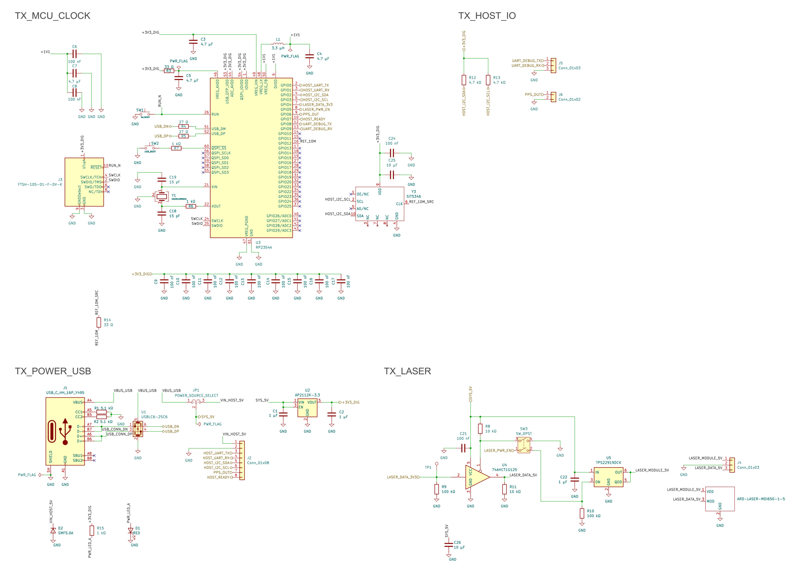
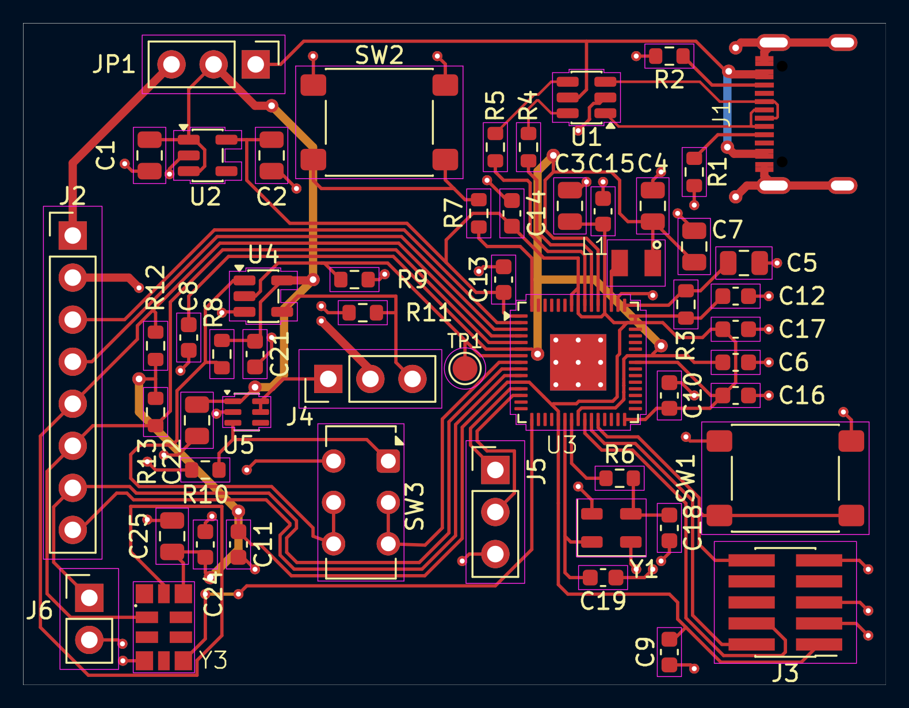
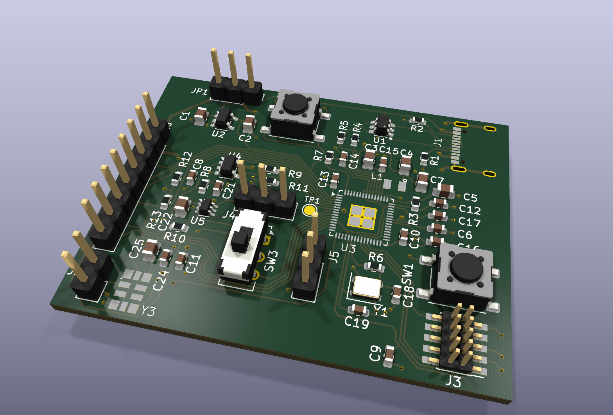
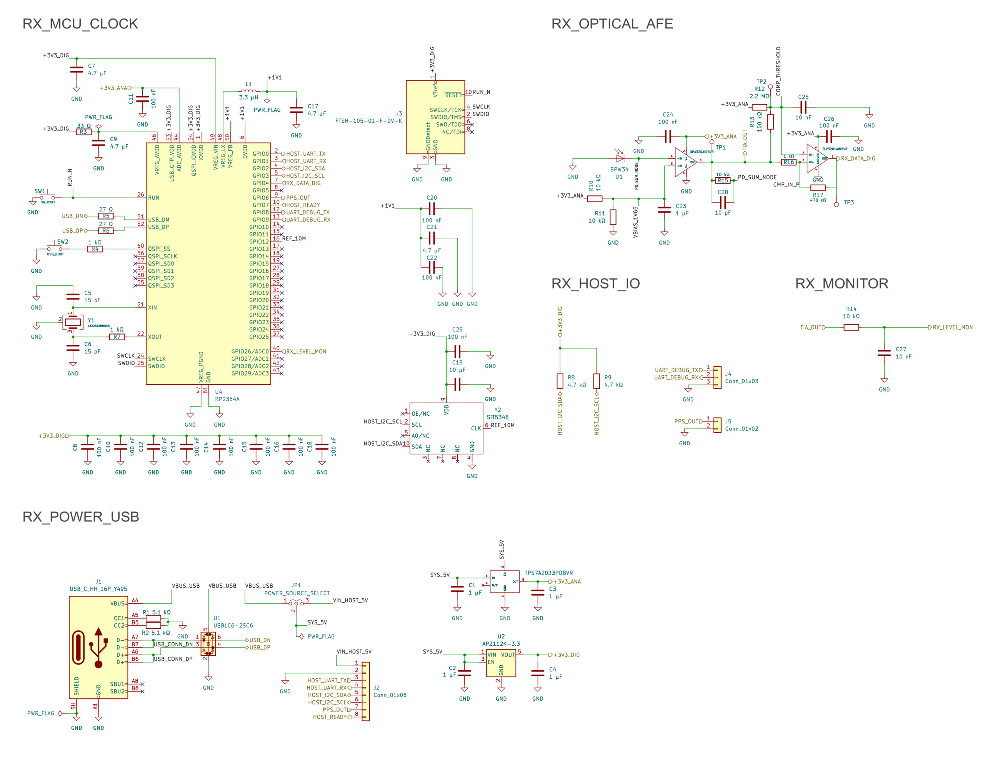
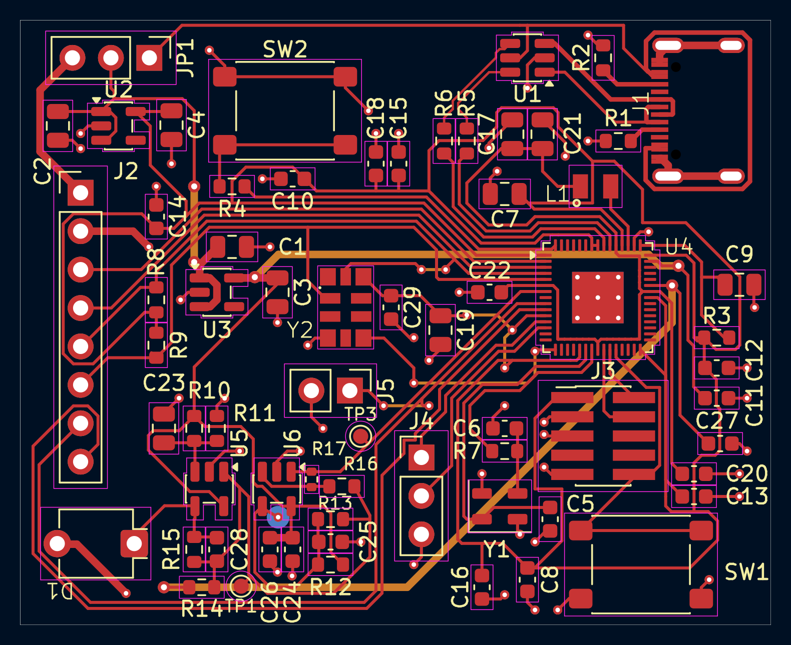
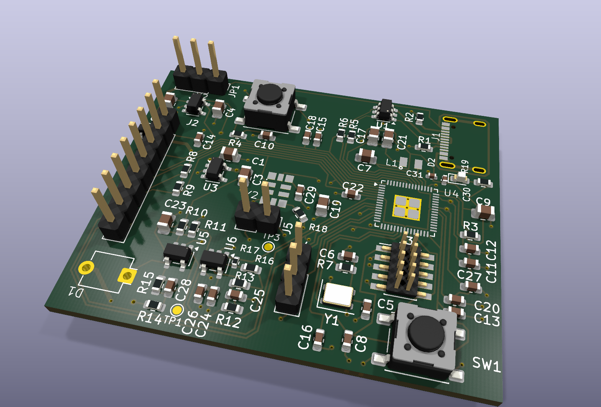

# A Free Space Optical Communication
This project implements a free-space optical communication link using two separate KiCad-designed boards: a transmitter and a receiver. The transmitter uses an RP2354A microcontroller to frame arbitrary digital payloads into packets and generate $100 \mathrm{kbit/s}$ RZ-OOK modulation for a $650 \mathrm{nm}$ laser module through a level-shifting buffer and an independent hardware safety chain.
The receiver uses a BPW34 photodiode, OPA320 transimpedance amplifier, and TLV3201 comparator (with an adaptive, average-tracking threshold and hysteresis) to recover the optical pulses and feed them into an RP2354A for decoding, CRC verification, and delivery to the host system.
Both boards include USB-C, UART, SWD, a local $12 \mathrm{MHz}$ crystal, and a $10 \mathrm{MHz}$ SiTime SiT5346 DCTCXO reference. The SiT5346 is connected to the RP2354A through a GPIO/PIO clock input and is controllable over the existing $\text{I²C}$ bus. Each board also exposes a dedicated $1\mathrm{PPS}$ output generated by the RP2354A. The initial target is a stable free-space optical link over approximately $5$ meters.

## Architecture
Two separate $4$ layer boards:
- TX: RP2354A + USB-C + host I/O + $12 \mathrm{MHz}$ crystal + $10 \mathrm{MHz}$ SiT5346 DCTCXO + dedicated $1\mathrm{PPS}$ output + laser driver/safety chain + laser module + power LED + host-5 V TVS protection.
- RX: RP2354A + USB-C + host I/O + $12 \mathrm{MHz}$ crystal + $10 \mathrm{MHz}$ SiT5346 DCTCXO + dedicated $1\mathrm{PPS}$ output + BPW34 / OPA320 / TLV3201 optical receiver + ADC monitor + power LED + host-5 V TVS protection.

### TX
- TX_ROOT
- TX_POWER_USB
- TX_MCU_CLOCK
- TX_HOST_IO
- TX_LASER

### RX
- RX_ROOT
- RX_POWER_USB
- RX_MCU_CLOCK
- RX_HOST_IO
- RX_OPTICAL_AFE
- RX_MONITOR

### TX schamtics:

### TX PCB: 

### RX schamtics:

### RX PCB: 

## Design updates (November 2026)
- **JLCPCB stock swaps:** 12 MHz crystal → YXC X322512MMB4SI; laser arm switch SW3 → C&K JS202011CQN; J2 / TX J4 → Würth 2.54 mm headers; USB-C → HH 16P TYPE-C (Y495); SWD header → FTSH-105-01-F-DV-K.
- **RX optical front end:** TIA gain R15 = 10 kΩ with C28 = 10 pF; adaptive comparator threshold (R13 = 100 kΩ from TIA_OUT, R12 = 2.2 MΩ, C25 = 10 nF); hysteresis via R16 = 1 kΩ and R17 = 470 kΩ.
- **Protection and indicators:** host 5 V input TVS (TX D2 SMF5.0A, RX D3 CESD5V0D3); red power LED on +3V3_DIG (TX R15/D1, RX R19/D2); 10 µF bulk capacitor on the TX 5 V rail (C26).
- **10 MHz reference:** 33 Ω series source termination at each SiT5346 output (TX R14, RX R18; oscillator side net `REF_10M_SRC`).
- **Decoupling:** two extra 100 nF 0402 capacitors on RX (C30 at IOVDD pin 45, C31 at VREG_VIN pin 49). The RP2354A core-supply (DVDD) decoupling still needs a manual fan-out rework, since there is no room near those pins without rerouting.
- **Test points:** RX TP1 = TIA_OUT, TP2 = COMP_THRESHOLD (bottom side), TP3 = RX_DATA_DIG; TX TP1 = LASER_DATA_3V3. Laser power/data and GND are also on the TX J4 header pins.
- **Silkscreen:** bottom-side pin names for J2, JP1 (USB / HOST), J4, J5/J6, test points, and board name/revision. SW3 is marked **ARM** (slider toward the top end, pin 1) and **SAFE**, per the C&K JS circuit diagram; confirm with a meter before first laser use.
- **Panelization:** copper-to-edge clearance raised to 0.4 mm for V-scoring. TX and RX each have a 2×2 V-scored panel with rails, tooling holes and fiducials in `Manufacturing/TX/panel` and `Manufacturing/RX/panel`.
- **Manufacturing:** JLCPCB-format BOM and CPL files (single board and panel) are in `Manufacturing/TX` and `Manufacturing/RX`. The SiT5346 is sourced and fitted separately, so it is left out of those files.
- **Optical (not on the PCB):** fit a 650 nm band-pass (or red) filter and a short black tube over the BPW34 to reject ambient light.

## Library:
### Pre-built Components Compatibility Verfication:

Verified: Symbol and Footprint compatibility: 

1. RP2354A  ✓
2. AP2112K-3.3  ✓
3. SN74AHCT1G125DBVR  ✓
4. TPS22919DCKR  ✓
5. USBLC6-2SC6  ✓
7. REF2033  ✓
8. SMF5.0A TVS (Diode_SMD:D_SOD-123F, TX)  ✓
9. CESD5V0D3 TVS (Diode_SMD:D_SOD-323, RX)  ✓
10. KT-0603R red LED (LED_SMD:LED_0603_1608Metric)  ✓

### Costum Components:

1. SiT5346 ✓
2. OPA320  ✓
3. TLV3201 ✓
4. BPW34 (custom footprint)  ✓
5. TPS7A2033  (customed symbol) ✓
6. ABM8-272-T3_3225 (custom footprint), fitted with YXC X322512MMB4SI (12 MHz, 10 pF; replaces ABM8-272-T3)  ✓
7. AOTA-B201610S3R3-101-T (custom footprint) ✓
8. SW_CK_JS202011CQN_as_DPST (custom footprint) for C&K JS202011CQN slide switch (replaces ES22MCBE) ✓
9. Würth 61300311121, 1×3 2.54 mm header (replaces B3B-PH-K-S) ✓
10. Würth 61300811121, 1×8 2.54 mm header (replaces B8B-PH-K-S) ✓
11. ARD-LASER-MDI650-1-5 ✓
12. FTSH-105-01-F-DV-K (replaces FTSH-105-01-L-DV-K, same footprint) ✓
13. HH 16P TYPE-C (Y495), LCSC C52209111 (replaces USB4105-GF-A) ✓
